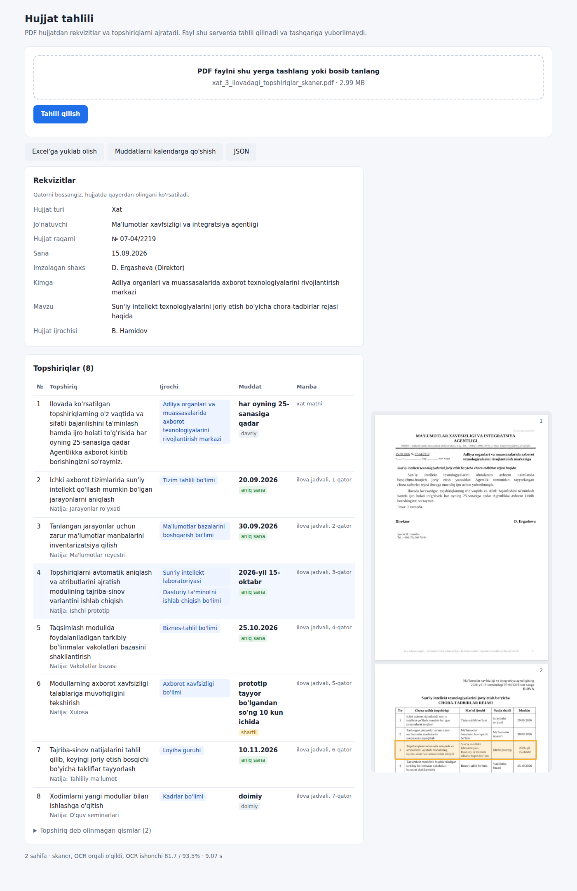

# 2-topshiriq. Hujjatlarni tahlil qilish

PDF hujjatdan (matnli yoki skaner) avtomatik ajratib oladi:

- **rekvizitlar:** jo'natuvchi tashkilot, hujjat raqami, sana, imzolagan shaxs;
- **topshiriqlar:** hujjatdagi har bir topshiriq, uning muddati va ijrochisi. Topshiriq abzatsda, bandda, jadvalda yoki ilovada kelishi mumkin.

Foydalanuvchi veb-sahifada PDF ni yuklaydi va «Tahlil qilish» tugmasini bosadi. Hammasi shu serverda ishlaydi, hujjat hech qanday tashqi xizmatga yuborilmaydi va diskka ham yozilmaydi.

**Sinab ko'rish:** [javi.uz/adliya/hujjat](https://javi.uz/adliya/hujjat/)



## Topshiriqdan tashqari qilinganlar

- **Natija hujjat ustida ko'rsatiladi.** Sahifaning o'ng tomonida hujjatning o'zi turadi. Topshiriq yoki rekvizit bosilsa, u hujjatning qayeridan olingani ramka bilan belgilanadi. Xodim natijani asl hujjat bilan bir qarashda solishtiradi va tizimga «ko'r-ko'rona» ishonmaydi.
- **Excel'ga yuklab olish.** Ikki varaq: topshiriqlar (ijrochi, muddat, muddat turi, sana, manba) va rekvizitlar. Devonxona yoki ijro nazorati bo'limi o'z jadvaliga ko'chiradi.
- **Muddatlarni kalendarga qo'shish (.ics).** Aniq sanasi bor har bir topshiriq kalendar hodisasi bo'ladi: Outlook, Google Calendar yoki telefonga import qilinadi.
- **Nazorat va hujjat ijrochisi alohida.** «Ijro nazorati ... zimmasiga yuklansin» bandi va hujjatni tayyorlagan xodim («Ijrochi: N. Sobirova») topshiriq ijrochisi bilan aralashtirilmaydi, alohida maydonda chiqadi.
- **Ogohlantirishlar.** Rekvizit topilmasa, ijrochi aniqlanmasa yoki skaner sifati past bo'lsa (OCR ishonchi 80% dan past), natija ostida «tekshiring» degan yozuv chiqadi.
- **Telefonda ham qulay.** Kichik ekranda jadval kartochkalarga aylanadi.

## Natija qisqacha

Berilgan 6 ta hujjat, har biri ikki ko'rinishda: matnli va skaner (jami 12 ta PDF).

| | Rekvizitlar | Topilgan topshiriqlar | Ortiqcha topshiriq | Ijrochi to'g'ri | Muddat to'g'ri |
|---|---|---|---|---|---|
| Matnli PDF | 24 / 24 | 39 / 39 | 0 | 39 / 39 | 39 / 39 |
| Skaner (OCR) | 24 / 24 | 39 / 39 | 0 | 39 / 39 | 39 / 39 |

Tezlik (oddiy CPU, GPU siz): matnli hujjat 0,3-0,6 soniya, skaner 4-9 soniya. Batafsil: [eval/results.md](eval/results.md).

**Muhim izoh.** Bu natija aynan shu 6 ta hujjat bo'yicha, qoidalar ham ularni ko'rib yozilgan. Shuning uchun boshqacha formatdagi buyruq ham yasab sinadim (pastda, 4-bo'lim). Unda birinchi urinishda 6 ta topshiriqdan 3 tasining ijrochisi chala chiqdi. Qoidalarni umumlashtirgandan keyin hammasi to'g'ri bo'ldi. Real yangi hujjatlarda ham shunday kamchiliklar chiqishi tabiiy. Ularni qanday o'lchash va yaxshilash kerakligi 5- va 6-bo'limlarda yozilgan.

## 1. Topshiriqni qanday tushundim

- **Ikki turdagi hujjat bor:** qaror va xat. Blankasi har xil. Qarorda jo'natuvchi «...KENGASHINING QARORI» ko'rinishida yoziladi, xatda esa tashkilot nomi ostida manzil va telefon turadi.
- **Topshiriqlar to'rt joyda keladi:** raqamlangan bandlarda, jadvalda, ilovadagi jadvalda va xatning raqamsiz xatboshisida («...taqdim etishingizni so'raymiz»). Oxirgisida ijrochi alohida yozilmaydi, ijrochi xatni oluvchi tashkilot bo'ladi.
- **Har bir band ham topshiriq emas.** «...qaror qiladi:» kirish, «reja ilovaga muvofiq tasdiqlansin» tasdiqlash, «ijrosini nazorat qilish ... zimmasiga yuklansin» nazorat. Bular topshiriqlar ro'yxatiga kirmaydi, nazorat alohida maydonda ko'rsatiladi.
- **Umumiy qoida bandi:** «Mazkur qarorda muddati alohida ko'rsatilmagan topshiriqlar bir oy muddatda ijro etilsin». Bu bandning o'zi topshiriq emas, lekin muddati yozilmagan topshiriqlarga muddat beradi. Tizim shu qoidani qo'llaydi va buni izohda ko'rsatadi.
- **«Ijrochi: N. Sobirova» qatori.** Bu imzolagan shaxs ham, topshiriq ijrochisi ham emas, hujjatni tayyorlagan xodim. Alohida maydonda chiqadi.
- **Muddatlar har xil yoziladi**, shuning uchun har biri turi bilan qaytariladi:

| Turi | Misol | Natijada |
|---|---|---|
| aniq sana | «2026-yil 1-iyulga qadar», «01.10.2026 yilgacha», jadvalda «18.09.2026» | sana: 2026-07-01 |
| hujjat sanasidan | «bir oy muddatda», «o'n kun muddatda», «uch ish kuni ichida» | hujjat sanasidan hisoblangan sana |
| shartli | «prototip tayyor bo'lgandan so'ng 15 kun ichida» | matn (boshlanish sanasi noma'lum) |
| davriy | «har oyda», «har oyning 5-sanasiga qadar», «har haftaning juma kuni» | matn |
| doimiy | «doimiy» | matn |
| boshlanish | «2026-yil 15-martdan boshlab» | boshlanish sanasi |

## 2. Yondashuv va arxitektura

```
PDF
 |-- matn qatlami bor --> so'zlar va ularning koordinatalari (PyMuPDF)
 |-- skaner ------------> qiyshiqlikni to'g'rilash, suv belgisini o'chirish --> OCR (Tesseract, uzb)
                                         |
              sahifa rasmidagi chiziqlardan jadval to'ri (OpenCV), har bir katak alohida
                                         |
              qatorlar va segmentlar (chap va o'ng ustun ajratiladi: sana | kimga, lavozim | F.I.Sh.)
                                         |
            +----------------------------+-------------------------------+
            |                                                            |
   rekvizitlar: blanka, № va sana qatori, imzo          topshiriqlar: bandlar, xat matni, jadval, ilova
                                                                         |
                                              o'zbekcha muddat iboralarini tushunish
                                                                         |
                                                    JSON  +  veb-sahifa
```

Asosiy qaror: **matnli PDF va skaner bitta yo'ldan o'tadi.** Skanerdan OCR orqali, matnli PDF dan to'g'ridan-to'g'ri so'zlar olinadi. Jadval esa ikkala holatda ham sahifa rasmidagi chiziqlar bo'yicha topiladi. Shu tufayli keyingi bosqichlar hujjat qaysi ko'rinishda kelganini bilmaydi ham. Sinov buni tasdiqladi: 12 ta PDF da natija bir xil.

Qanday ishlaydi (qisqacha):

1. **Qatorlar.** So'zlar balandligi bo'yicha qatorga yig'iladi. Qator ichida katta bo'shliq bo'lsa, u alohida segmentlarga bo'linadi. Bu muhim: sarlavhada chapda «08.09.2026 № 03-12/1456», o'ngda «...markaziga» turadi. Imzo qatorida chapda lavozim, o'ngda ism.
2. **Rekvizitlar.** Jo'natuvchi blankadan olinadi va oddiy yozuvga o'tkaziladi («RAQAMLI HUQUQIY XIZMATLAR AGENTLIGI» -> «Raqamli huquqiy xizmatlar agentligi», qarorda «KENGASHINING» -> «kengashi»). Raqam «№» belgisidan keyin, sana shu qatordan. Imzolagan shaxs: chapda lavozim («raisi», «direktor», «o'rinbosari»), o'ngda «M. Tursunov» ko'rinishidagi ism turgan qator.
3. **Bandlar.** Xatboshilar chekinish va raqam («1.») bo'yicha ajratiladi. Har biri turkumlanadi: topshiriq (buyruq fe'li «-sin», «-silar» yoki iltimos «so'raymiz»), kirish, tasdiqlash, nazorat, umumiy qoida.
4. **Ijrochi.** O'zbek tilida ega gap boshida turadi: «Axborot texnologiyalari boshqarmasi ... ta'minlasin». Ijrochi gap boshidagi ot birikmasi, oxirgi so'zi tashkiliy birlik (bo'limi, boshqarmasi, departamenti, laboratoriyasi ...). «Markazning Tizim tahlili bo'limi» kabi qaratqichli birikmalar to'liq olinadi. «X bilan birgalikda» hamkor ijrochi sifatida qo'shiladi.
5. **Jadval.** Sarlavha qatoridagi so'zlardan ustunlar aniqlanadi: «Topshiriq mazmuni» yoki «Chora-tadbir», «Mas'ul ijrochi», «Muddat», «Natija shakli». Bir katakdagi bir nechta ijrochi vergul bo'yicha ajratiladi. Sarlavhasiz jadval keyingi sahifadagi davom deb olinadi.
6. **Muddat.** Aniq sana, nisbiy, shartli, davriy va doimiy iboralar uchun alohida qoidalar. Nisbiy muddat hujjat sanasidan hisoblanadi, «ish kuni» da shanba va yakshanba o'tkazib yuboriladi.

## 3. Nega shu texnologiyalar

- **PyMuPDF:** matn qatlamini so'z koordinatalari bilan beradi, tez va o'rnatish oson.
- **Tesseract 5, o'zbek lotin modeli:** ochiq, internetsiz ishlaydi, CPU yetadi. Skanerlarda belgi xatosi 0,5-6% chiqdi (pastda).
- **OpenCV:** jadval chiziqlarini topish uchun. Jadval katagini alohida o'qish butun sahifani bir yo'la o'qishdan ancha aniq. Skaner 150 dpi da berilgan, shuning uchun sahifa 300 dpi ga kattalashtiriladi, och kulrang suv belgisi va dog'lar o'chiriladi.
- **Qoidalar va o'zbek tili grammatikasi, LLM emas.** Sabablari:
  1. Rasmiy hujjat qolipi qat'iy: blanka, raqam, sana, band, imzo doim o'z joyida turadi.
  2. Qoida natijani «o'ylab topmaydi». Har bir qiymat hujjatdan aynan olinadi va qayerdan olingani ko'rsatiladi («3-band», «ilova jadvali, 2-qator»).
  3. GPU kerak emas, matnli hujjat 1 soniyadan tez tahlil qilinadi.
  4. Xato chiqsa, sababini topish va tuzatish oson.

  Kamchiligi ham bor: yangi turdagi hujjat uchun qoidani qo'shish kerak bo'ladi. Shuning uchun keyingi bosqichda lokal LLM bilan gibrid qilishni rejalashtirganman (6-bo'lim).

## 4. Natijani qanday tekshirdim

- `eval/gold.json`: 6 ta hujjat uchun to'g'ri javoblarni qo'lda belgiladim. 39 ta topshiriq, har biriga ijrochi va muddat.
- `eval/evaluate.py` 12 ta PDF ni tahlil qilib, maydonma-maydon solishtiradi. Rekvizitlar aniq moslik bo'yicha tekshiriladi. Topshiriqlar matn o'xshashligi bo'yicha juftlanadi, so'ng ijrochilar to'plami va muddat alohida tekshiriladi. Ortiqcha topilgan topshiriq ham xato hisoblanadi.
- OCR sifati alohida o'lchandi: skaner matni matnli PDF dagi asl matn bilan solishtirildi (CER, belgilar bo'yicha xato ulushi).

| Hujjat | OCR xatosi (CER) |
|---|---|
| NAMUNA_1_abzats | 0,47% |
| NAMUNA_2_jadval | 0,66% |
| NAMUNA_3_ilova | 0,59% |
| xat_1_abzatsdagi_topshiriqlar | 1,69% |
| xat_2_jadvaldagi_topshiriqlar | 2,04% |
| xat_3_ilovadagi_topshiriqlar | 5,99% |

OCR xatolari topshiriqlarni aniqlashga ta'sir qilmadi. Masalan, xat_2 skanerida «AI modullarining» «AT modullarining» deb o'qildi, matnda shunday qoladi.

**Boshqacha formatdagi hujjat.** Qoidalar faqat berilgan hujjatlarga moslashib qolmaganini tekshirish uchun boshqacha buyruq yasadim (`eval/make_synthetic.py`). Unda «B U Y R U G' I» sarlavhasi, «3 oktyabr 2026 yil» kabi so'z bilan yozilgan sana, «... boshqarmasi tomonidan ... o'tkazilsin» passiv gapi, «Moliya bo'limi boshlig'i» kabi lavozimli ijrochi, ikki qatorga bo'lingan imzo lavozimi va boshqacha jadval sarlavhasi («Tadbir nomi | Ijrochi | Bajarish muddati») bor. Skaner ko'rinishi ham yasaldi: 150 dpi, 0,6 daraja qiyshiq, shovqinli.

Birinchi urinishda 6 ta topshiriqning hammasi topildi, lekin 3 tasining ijrochisi chala chiqdi («Moliya bo'limi boshlig'i» o'rniga «Moliya bo'limi», passiv gapda nomning boshi kesildi). Imzolagan shaxsning lavozimi ham chala o'qildi. Bu xatolar umumiy edi, qoidalarni kengaytirdim. Endi bu hujjat ham, berilgan 12 ta PDF ham to'liq to'g'ri.

Belgilashda o'zim qaror qilgan bahsli joylar:

- **NAMUNA_1, 3-band:** muddati yozilmagan, 6-banddagi umumiy qoida bo'yicha «bir oy muddatda» (2026-03-10) deb olindi.
- **NAMUNA_1, 4-band:** «2026-yil 15-martdan boshlab» tugash muddati emas, boshlanish sanasi.
- **NAMUNA_3, 2-band:** «Ilovada belgilangan topshiriqlar ... ijro etilishi ta'minlansin». Bu alohida topshiriq emas, umumiy ko'rsatma.
- **xat_2, jadvaldan keyingi gap:** «...ma'lumot loyiha koordinatori orqali ... taqdim etilsin». Ijrochi «Loyiha koordinatori», muddat ko'rsatilmagan.
- **xatlardagi iltimoslar** («...taqdim etishingizni so'raymiz»): ijrochi xatni oluvchi tashkilot.

## 5. Cheklovlar va xato qilishi mumkin bo'lgan joylar

- **Qoidalar shu 6 ta hujjatda sozlangan.** Boshqacha blanka (logotipli, ikki ustunli), boshqacha yozilgan sana («3 oktyabr 2026 y.») yoki ijrochi gap oxirida kelsa («... tayyorlash Kadrlar bo'limiga yuklatilsin»), xato bo'lishi mumkin.
- **Ijrochi lug'at orqali topiladi.** Gap boshidagi birikmaning oxirgi so'zi tashkiliy birliklar ro'yxatida bo'lishi kerak. Ro'yxatda yo'q birlik («Ishchi guruh», «Hokim yordamchisi») topilmasligi mumkin.
- **Faqat chiziqli jadvallar.** Chiziqsiz (bo'shliq bilan tekislangan) jadvalni hozir jadval deb tanimaydi.
- **OCR.** Past sifatli skanerda (150 dpi dan past, muhr ustidagi matn, qo'lda yozilgan izoh) xato ko'payadi. OCR ishonchi 80% dan past bo'lsa, natija ostida «tekshiring» ogohlantirishi chiqadi.
- **Kirill yozuvidagi hujjat.** OCR da `uzb_cyrl` modeli bor, lekin qoidalar lotin yozuvi uchun yozilgan. Kirill hujjatni avval lotinga o'girish qadamini qo'shish kerak (1-topshiriqdagi transliteratsiya kodi shunga mos).
- **Muddat hisobi.** Nisbiy muddat hujjat sanasidan hisoblanadi. Bayram kunlari hisobga olinmaydi, faqat shanba va yakshanba.

## 6. Qanday davom ettirardim

1. **Ko'proq hujjat yig'ish va belgilash.** 100-200 ta real hujjat, har biriga rekvizit, topshiriq, ijrochi, muddat. `gold.json` formati shunga tayyor. Shundan keyingina haqiqiy aniqlik ma'lum bo'ladi.
2. **Gibrid: qoidalar va lokal LLM.** Qoida ishonchli joyda o'zi ishlaydi. Qoidaga tushmagan yoki ishonchi past band lokal LLM ga beriladi (masalan, Qwen 7-8B, vLLM yoki llama.cpp orqali, internetsiz). LLM javobi tekshiriladi: har bir maydon hujjat matnida aynan bormi, sana to'g'ri formatdami. Shu tekshiruvdan o'tmagan javob operatorga yuboriladi.
3. **LLM ni o'z hujjatlarimizda o'qitish.** Belgilangan hujjatlar bo'yicha LoRA bilan fine-tuning, chiqishni qat'iy JSON sxemasi bilan cheklash.
4. **Chiziqsiz jadvallar uchun layout modeli** (masalan, PP-Structure yoki Table Transformer).
5. **Ijrochini tashkilot tuzilmasiga bog'lash.** «Tizim tahlili bo'limi» -> bo'lim ID si. Shunda topshiriqni avtomatik yo'naltirish va ijrosini kuzatish mumkin bo'ladi.

## 7. Ishga tushirish

Docker orqali:

```bash
cd task2-docs
docker compose up -d --build
# brauzerda: http://127.0.0.1:8080
```

Docker'siz:

```bash
sudo apt install tesseract-ocr tesseract-ocr-uzb
pip install -r requirements.txt
uvicorn app.web:app --port 8080
```

API:

```bash
curl -F "file=@samples/skaner/xat_1_abzatsdagi_topshiriqlar_skaner.pdf" http://127.0.0.1:8080/api/analyze
```

Javob (qisqartirilgan):

```json
{
  "requisites": {"doc_type": "Xat", "sender": "Raqamli huquqiy xizmatlar agentligi", "number": "03-12/1456",
                 "date": "2026-09-08", "signatory": "Sh. Qodirov", "signatory_position": "Direktor o'rinbosari",
                 "addressee": "Adliya organlari va muassasalarida axborot texnologiyalarini rivojlantirish markazi",
                 "preparer": "N. Sobirova"},
  "tasks": [
    {"n": 3, "source": "3-band",
     "text": "Axborot xavfsizligi bo'limi Sun'iy intellekt laboratoriyasi bilan birgalikda ... o'n kun muddatda kiritsin.",
     "executors": ["Axborot xavfsizligi bo'limi", "Sun'iy intellekt laboratoriyasi"],
     "deadline": {"text": "o'n kun muddatda", "type": "nisbiy", "date": "2026-09-18"}}
  ],
  "control": [], "warnings": [], "meta": {"pages": 1, "source": "ocr", "ocr_confidence": [93.5], "seconds": 5.2}
}
```

Excel: `POST /api/export` (tahlil natijasi JSON ko'rinishida yuboriladi, `.xlsx` qaytadi).

Baholashni qayta ishga tushirish: `python -m eval.evaluate` (natija `eval/results.md` ga yoziladi). Avtomatik testlar: `pytest tests` (33 ta: o'zbekcha muddat iboralari, 14 ta PDF ning har biri, noto'g'ri faylni rad etish).

Xavfsizlik: fayl faqat PDF, 20 MB va 30 sahifagacha qabul qilinadi. Fayl diskka yozilmaydi. Konteyner root huquqida emas, alohida foydalanuvchi nomidan ishlaydi: yuklangan fayl bilan ishlovchi jarayon cheklangan bo'lishi kerak. Docker porti faqat `127.0.0.1` ga ochiladi, tashqariga nginx orqali HTTPS bilan chiqariladi, so'rovlar soni IP bo'yicha cheklangan.

Yuklama sinovi (`tools/loadtest.py docs`, matnli va skaner PDF aralash, GPU siz):

| Holat | Hujjat/s | Mediana | p95 | Xato |
|---|---|---|---|---|
| 1 foydalanuvchi | 0,36 | 3,9 s | 6,9 s | 0 |
| 4 kishi bir vaqtda | 1,2 | 4,4 s | 7,8 s | 0 |

Har bir hujjat alohida ishlanadi va OCR jadval kataklarini parallel o'qiydi, shuning uchun bir vaqtda bir necha hujjat kelsa, sig'im deyarli shunga mos oshadi.

## Kod tuzilmasi

| Fayl | Vazifasi |
|---|---|
| `app/extract.py` | PDF sahifasi: matn qatlami yoki OCR, rasmni tozalash, jadval to'rini topish |
| `app/layout.py` | so'zlardan qatorlar va segmentlar, OCR xatolarini tozalash |
| `app/requisites.py` | jo'natuvchi, raqam, sana, imzolagan shaxs, kimga, mavzu, hujjat ijrochisi |
| `app/tasks.py` | bandlarni turkumlash, ijrochi, jadval va ilova |
| `app/dates.py` | o'zbekcha sana va muddat iboralari |
| `app/pipeline.py` | hammasini birlashtiradi, ogohlantirishlar |
| `app/web.py` | veb-sahifa, `/api/analyze`, `/api/export` |
| `app/export.py` | Excel fayl |
| `eval/` | to'g'ri javoblar, baholash skripti, boshqacha formatdagi sinov hujjati |
| `tests/` | avtomatik testlar |
